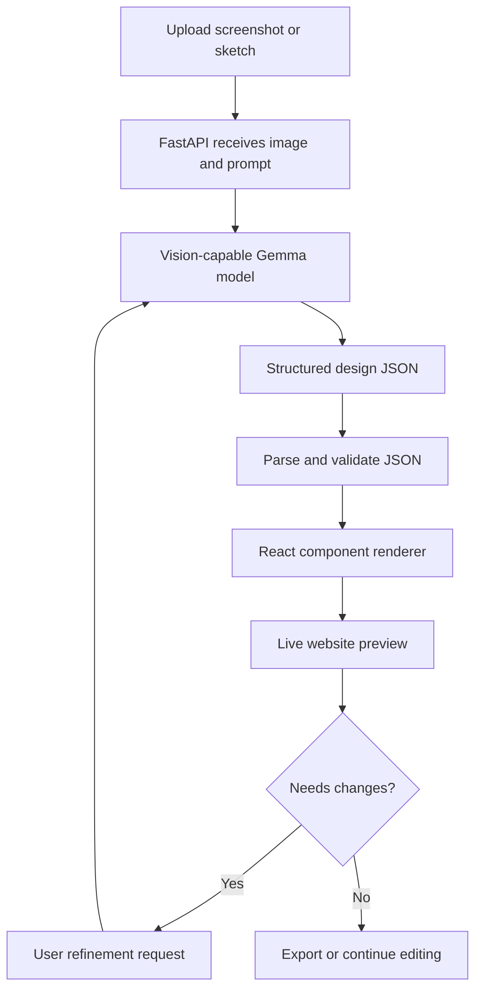

# Visioncoder

**Turn screenshots and sketches into editable, responsive websites with AI.**

Visioncoder is an AI-assisted sketch-to-website project that aims to transform a reference image into a structured design description, then render that description as a working web page. Instead of treating the image as a prompt for a one-off screenshot, Visioncoder uses a structured pipeline so the generated interface can be previewed and refined.

> **Project status:** This README describes the intended architecture and development workflow. Some capabilities may still be under development. Update the feature checklist and configuration names to match the current implementation before publishing.

## Table of contents

- [How it works](#how-it-works)
- [Core features](#core-features)
- [Architecture](#architecture)
- [Technology stack](#technology-stack)
- [Getting started](#getting-started)
- [Environment configuration](#environment-configuration)
- [API and development](#api-and-development)
- [Project structure](#project-structure)
- [Safety and reliability](#safety-and-reliability)
- [Roadmap](#roadmap)
- [Troubleshooting](#troubleshooting)
- [Contributing](#contributing)
- [License](#license)
- [Acknowledgements](#acknowledgements)

## How it works

1. **Upload a reference** — provide a website screenshot, UI mockup, or hand-drawn wireframe.
2. **Analyze the image** — a vision-capable Gemma model interprets the layout, visual hierarchy, colors, typography, and visible UI components.
3. **Produce design JSON** — the model is prompted to return a structured description of the page rather than arbitrary executable code.
4. **Validate the result** — the backend parses and validates the JSON against the application's expected schema.
5. **Render the website** — the frontend maps approved component types and design properties to React components and CSS.
6. **Preview and refine** — inspect the generated page, provide change requests, and iterate on the design.



### Example design JSON

The model output should follow the schema defined by the application. The following is an illustrative example, not a guaranteed response format:

```json
{
  "page": "landing",
  "theme": {
    "background": "#ffffff",
    "primary": "#635bff"
  },
  "layout": "two-column",
  "components": [
    {
      "type": "navbar",
      "position": "top"
    },
    {
      "type": "heading",
      "text": "Build Something Great"
    },
    {
      "type": "button",
      "text": "Get Started"
    }
  ]
}
```

## Core features

- Reference-image-driven UI generation.
- AI-assisted interpretation of page structure and styling.
- Structured JSON as the bridge between image analysis and frontend rendering.
- React-based preview workflow.
- Iterative refinement from natural-language instructions.
- Responsive design as a generation target.

Features such as code export, multi-page generation, undo/redo, or automatic repair should only be marked complete once they are implemented and tested.

## Architecture

| Layer | Responsibility |
|---|---|
| Frontend | React + TypeScript UI for image upload, prompts, editing controls, and preview. |
| Backend API | FastAPI receives requests, coordinates model calls, validates results, and returns structured data. |
| Vision model | A vision-capable Gemma variant analyzes the reference image. |
| Design schema | Defines allowed page properties, component types, and style values. |
| Renderer | Converts validated JSON into approved React components and CSS. |
| Preview | Displays the generated website, ideally in an isolated iframe or sandbox. |

**Model compatibility matters:** use a Gemma variant and serving method that support image input. A text-only model cannot directly analyze an uploaded screenshot. Confirm the selected model's input and output capabilities in its official documentation.

## Technology stack

The project is organized around the following stack:

- **Frontend:** React, TypeScript, Vite
- **Backend:** Python, FastAPI, Uvicorn
- **AI:** Gemma / Google GenAI integration (depending on the configured provider and model)
- **Validation:** JSON parsing and schema validation on the backend
- **Styling:** CSS and the existing frontend styling system

Check the current `package.json`, backend dependency file, and environment configuration for the exact installed versions and provider setup.

## Getting started

### Prerequisites

- Git
- Node.js and npm
- Python 3.10+ (use the version supported by your installed dependencies)
- A supported API credential or local model setup for the configured AI provider

### 1. Clone the repository

```bash
git clone <YOUR_REPOSITORY_URL>
cd <YOUR_REPOSITORY_DIRECTORY>
```

Replace the placeholders with your repository URL and directory name.

### 2. Start the backend

Open a terminal:

```powershell
cd backend
python -m venv .venv
.\.venv\Scripts\Activate.ps1
python -m pip install --upgrade pip
```

Install the backend dependencies using the dependency file included in your repository. For example, if it contains `requirements.txt`:

```powershell
pip install -r requirements.txt
```

Create the backend `.env` file using the configuration section below, then start the API:

```powershell
python -m uvicorn app.main:app --reload --host 127.0.0.1 --port 8001
```

Useful local URLs, if enabled by the application:

- Health endpoint: `http://127.0.0.1:8001/health`
- Interactive API docs: `http://127.0.0.1:8001/docs`

### 3. Start the frontend

Open a second terminal:

```powershell
cd frontend
npm install
npm run dev
```

Open the local URL printed by Vite, commonly `http://localhost:5173`.

### 4. Try the workflow

1. Upload a clear screenshot or sketch.
2. Enter a prompt describing what should be recreated.
3. Submit the generation request.
4. Review the generated page in the preview.
5. Provide a specific refinement request, such as “increase the hero spacing” or “make the cards stack on mobile.”

## Environment configuration

Create `backend/.env` and add the variables required by the actual backend implementation. A typical configuration may look like this:

```dotenv
# Use the exact variable names read by your backend code.
GEMINI_API_KEY=your_api_key_here
GEMINI_MODEL=your_vision_capable_model_id
```

The variable names above are examples; check the backend configuration code and use its exact names. Do not commit `.env` files, API keys, access tokens, or other secrets. Keep credentials on the backend and never expose them in frontend code.

## API and development

FastAPI's interactive documentation is commonly available at:

```text
http://127.0.0.1:8001/docs
```

Use it to inspect the API routes actually registered by the backend. The exact request fields and response schema depend on the implementation, so this README intentionally does not invent endpoint names or payload formats.

Recommended API behavior:

- Validate image type and file size before processing.
- Validate model output as JSON before returning it to the frontend.
- Return clear error messages for invalid images, model failures, and schema errors.
- Apply timeouts and sensible rate limits to model calls.
- Keep model credentials and provider calls on the server.
- Log diagnostic details without logging secrets or unnecessarily storing uploaded images.

## Project structure

The following is a conceptual structure. The exact files may differ in the current repository.

```text
Visioncoder/
├── frontend/
│   ├── src/
│   │   ├── components/
│   │   └── App.tsx
│   ├── package.json
│   └── vite.config.ts
├── backend/
│   ├── app/
│   │   └── main.py
│   ├── .env                 # local only; do not commit
│   └── requirements.txt     # if used by this repository
├── .gitignore
├── LICENSE
└── README.md
```

## Safety and reliability

AI-generated output is not guaranteed to match the reference perfectly. Small text, complex layouts, and dense screenshots may be interpreted incorrectly. Validate the design JSON before rendering and handle malformed or incomplete output gracefully.

Treat generated markup, styles, and code as untrusted input. Prefer rendering from a restricted set of approved React components and style properties. If arbitrary generated code must be executed, isolate it in a sandboxed environment with a restrictive Content Security Policy; do not execute it directly in the main application context.

Also consider:

- Limiting upload size and accepting only supported image formats.
- Avoiding unnecessary retention of uploaded images.
- Adding accessible labels, keyboard navigation, and responsive checks.
- Showing useful loading, retry, and failure states.

## Roadmap

- [ ] Improve image-to-layout analysis and structured output consistency.
- [ ] Define and version a strict design JSON schema.
- [ ] Expand the approved component library.
- [ ] Improve responsive layout generation.
- [ ] Add targeted refinement of existing components.
- [ ] Add export/download support for generated projects.
- [ ] Add automated schema, API, and frontend build tests.
- [ ] Add visual comparison tools to measure similarity to the reference.

## Troubleshooting

### Backend does not start

- Confirm the virtual environment is activated.
- Install dependencies from the repository's backend dependency file.
- Verify `.env` contains the variables expected by the code.
- Read the full Uvicorn traceback before changing configuration.

### Model request fails

- Check the API key locally without pasting it into chats, issues, or logs.
- Confirm the configured model supports image input.
- Check provider quotas, connectivity, and model identifier.
- Handle provider failures and timeouts without returning misleading successful output.

### Frontend cannot reach the backend

- Confirm the backend is running on the configured host and port.
- Check the frontend's API base URL and backend CORS configuration.
- Inspect the browser console and network panel for the actual failing request.

### Generated JSON cannot be rendered

- Validate the model response before rendering.
- Check that component types match the renderer's supported set.
- Add a clear error state and retry/refinement path instead of crashing the preview.

## Contributing

Contributions, bug reports, and ideas are welcome.

1. Fork the repository.
2. Create a focused branch for your change.
3. Make the change and add or update tests where practical.
4. Run the available backend tests and frontend build.
5. Open a pull request with a clear description and screenshots for UI changes.

Please do not include API keys, private user screenshots, or other sensitive data in issues or pull requests.

## License

This project is licensed under the **MIT License**. See [`LICENSE`](LICENSE) for the full license text.

The MIT License applies to the original project code and documentation owned by the project contributors. Third-party dependencies, model weights, APIs, fonts, and external assets remain subject to their own terms and licenses.

## Acknowledgements

- [Google Gemma](https://ai.google.dev/gemma) for the model family and vision-language capabilities.
- [React](https://react.dev/), [TypeScript](https://www.typescriptlang.org/), and [Vite](https://vite.dev/) for the frontend tooling.
- [FastAPI](https://fastapi.tiangolo.com/) for the backend API framework.

---

Built as an experiment in making interface creation faster, more accessible, and easier to iterate on.
